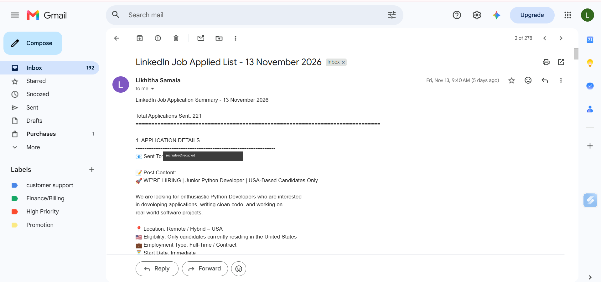

# Automated Job Application & Cover Letter Agent

An n8n workflow that reads LinkedIn hiring posts every morning, picks the ones worth applying
to, writes a tailored application email for each, and sends it with my resume attached — while
I'm asleep.

Built because a good application takes 10–15 minutes by hand. Doing 200 of them is not
possible alongside a full-time job. This does it in one 49-minute run.


---

## What it does

```
03:00 daily
  → Apify scrapes LinkedIn hiring posts (8 search queries, last 24h)
  → Remove duplicate posts
  → Job-fit filter  (plain JavaScript, no LLM — code/job-fit-filter.js)
  → Skip anything already applied to (5,000-post memory)
  → LLM pulls the recruiter's email out of the post text
  → LLM writes a tailored application email
  → Gmail sends it + resume PDF, from 3 rotating accounts
  → One summary email to me
```

**One run:** 320 posts scraped → 282 pass the filter → ~160 have a reachable email → **~200
applications sent.**



---

## The filter is the important part

The first version had no filter — it applied to anything containing an email address, including
internships, 10+ year roles and other people's "open to work" posts. 194 wasted emails in one
night.

[`code/job-fit-filter.js`](code/job-fit-filter.js) now runs **before** any LLM call, so API
credit is only spent on real openings. It rejects:

- internships (the one hard block)
- other people's "#opentowork / please refer me" posts
- unpaid, commission-only and equity-only roles
- C-suite searches (CEO / CTO / VP / Head of Engineering)
- non-tech roles (telecaller, sales, insurance, content writer)
- empty posts with no title

Everything else is accepted, including roles asking for 1+, 4+, 7+ or 10+ years, and posts that
never mention years at all.

The email prompt is also locked down: the LLM may only state facts from one candidate profile
block, and may only name a technology if it appears in **both** the profile and the job post —
so it cannot invent skills or experience.

---

## Stack

| Part | Tool |
| --- | --- |
| Orchestration | n8n (self-hosted, 71 nodes) |
| Scraping | Apify — `harvestapi/linkedin-post-search` (no LinkedIn login needed) |
| LLM | Groq — `openai/gpt-oss-120b` and `gpt-oss-20b` |
| Email | Gmail API (OAuth2), 3 rotating accounts |
| Filtering | Plain JavaScript in a Code node |

---

## Setup

### 1. Import it
Download [`workflow/job-apply-agent.json`](workflow/job-apply-agent.json) →
in n8n: **Workflows → ⋯ → Import from File**

It imports **inactive**. Nothing sends until you switch it on.

### 2. Add your three API keys
**No keys are in this repo** — every credential is a placeholder called `REPLACE_ME`. In n8n go
to **Credentials → Add credential**, create these three, then open the red-marked nodes and
pick the matching credential:

| Credential | Get the key from | Free? |
| --- | --- | --- |
| **Apify API** | [apify.com](https://apify.com) → Settings → Integrations → API token | $5 free credit/month |
| **Groq API** | [console.groq.com](https://console.groq.com) → API Keys | Yes |
| **Gmail OAuth2** | Google Cloud Console → enable Gmail API → OAuth client ID | Yes |

Sign up to Apify with your Google account — no card needed.

> **Cost warning:** the scraper costs **$0.002 per post**. This repo ships with `maxPosts: 40`
> (320 posts/day ≈ $19/month), which is **more than the $5 free credit**. To stay free, open the
> **Run an Actor1** node and set `"maxPosts": 10`.
>
> When Apify credit runs out the run fails with **HTTP 402 in under a second, with no warning**.
> If the agent ever just stops, check your Apify balance first.

### 3. Replace my details with yours

| What | Which node |
| --- | --- |
| Your resume (Drive file ID) | the 9 `HTTP Request` nodes — URL ends `id=YOUR_RESUME_FILE_ID` |
| Your name, experience, skills | `AI Agent2`, `AI Agent5`, `AI Agent6` → the `CANDIDATE PROFILE` block |
| Where the summary email goes | `Send a message8` |
| The roles you want | `Run an Actor1` → `searchQueries` |

Upload your resume to Google Drive, set sharing to *Anyone with the link*, and copy the file ID
out of the URL.

### 4. Test before switching it on
Set `maxPosts: 2`, disable every Gmail node (select → `D`), run it, and walk through the data.

> **Gotcha:** `Dedupe Across Runs` records items as soon as they pass through, so a test run
> marks real jobs as "already seen" and your first live run skips them. After testing, set that
> node's operation to `clearDeduplicationHistory`, run once, then set it back to
> `removeItemsSeenInPreviousExecutions`.

---

## Files

| File | What it is |
| --- | --- |
| `workflow/job-apply-agent.json` | **The workflow.** Import this into n8n. All 71 nodes, no credentials. |
| `code/job-fit-filter.js` | The filter code, pulled out so it's readable on GitHub without importing anything. Identical to the code inside the workflow. |
| `docs/` | Screenshots used in this README. |
| `.env.example` | A list of every key you need and where to get it. Blank — it's a checklist, not a secret. |
| `.gitignore` | Tells git never to upload real keys, resumes or run data. |
| `LICENSE` | MIT — anyone may use and modify this. |

---

## Please use it responsibly

This sends real email to real recruiters. Keep the filter strict so every email is to a role
that genuinely fits, and keep the truth rules in the prompt — an application that invents
experience fails at the first interview. Scraping public LinkedIn posts sits in a grey area
with LinkedIn's terms; this is a portfolio and learning project, run at your own risk.

---

MIT licensed · Built by **Likhitha Samala** ·
[Portfolio](https://likhitha-portfolio-neon.vercel.app/) ·
[GitHub](https://github.com/Likhithasamala)
