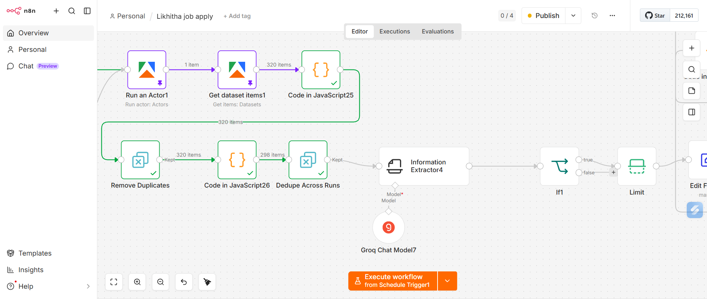
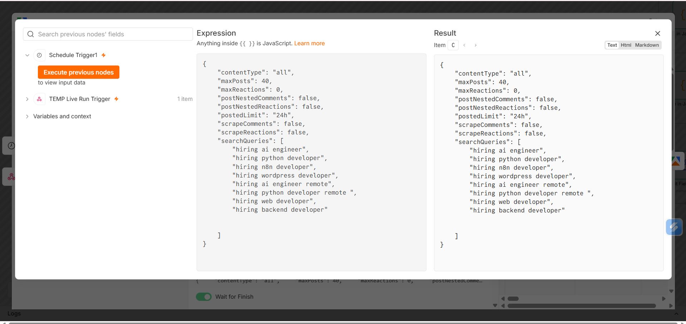
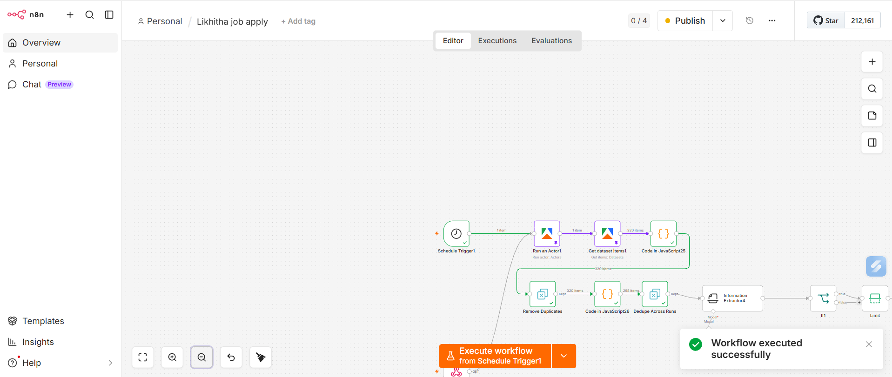

# 🤖 Automated Job Application & Cover Letter Agent

> An n8n agent that reads LinkedIn hiring posts every morning, decides which ones are worth
> applying to, writes a genuinely tailored application email for each, and sends it with my
> resume attached — before I wake up.

<p align="center">
  
  <br>
  <em>A single scheduled run: 320 posts scraped → 298 survive dedupe → filtered, written and sent.</em>
</p>

<p align="center">
  
  
  
  
  
</p>

---

## Why I built this

I was job hunting while working full time. The honest maths of that is brutal: a good
application — read the post, work out whether it even fits, write an email that isn't obviously
a template, find the recruiter's address, attach the resume — takes **10 to 15 minutes**. Doing
twenty of those is a four-hour second shift, every single day, on top of a job.

So most evenings I managed four or five, and they were the four or five that happened to be at
the top of my feed. Not the best ones. Just the most recent ones.

This agent does the part that was never the valuable part. It runs at **3:00 AM**, and by the
time I open my laptop there is one summary email waiting with everything it sent overnight. My
time goes to the interviews instead of the applications.

<p align="center">
  
  <br>
  <em>The morning summary — 221 applications sent in a single overnight run.</em>
</p>

---

## What it actually does

```
  ⏰ 03:00 daily
      │
      ▼
  ① Apify scrapes LinkedIn hiring posts        8 search queries × 40 posts, last 24h
      │
      ▼
  ② Dedupe by post URN                          drops reposts inside this run
      │
      ▼
  ③ 🧠 Job-fit filter  (pure JS, no LLM)        the brain — see code/job-fit-filter.js
      │
      ▼
  ④ Dedupe across runs                          5 000-post memory, never applies twice
      │
      ▼
  ⑤ LLM extracts the recruiter's email          posts hide it in prose, not a field
      │
      ▼
  ⑥ LLM writes a tailored application email     grounded in a strict candidate profile
      │
      ▼
  ⑦ Gmail sends it + resume PDF attached        3 rotating accounts, randomised delays
      │
      ▼
  ⑧ 📬 One summary email to me
```

### The part I'm actually proud of: the filter

The first version of this had **no filter at all**. The only test was "does this post contain an
email address?" It sent 194 applications in one night — to internships, to roles asking for
10+ years, and to other job seekers' *"#opentowork, please refer me"* posts. It was spam, and
it was embarrassing.

[`code/job-fit-filter.js`](code/job-fit-filter.js) is the fix, and it runs **before** any LLM
call or email, so the API budget is only ever spent on real openings:

| Rejected | Why |
| --- | --- |
| Internships | The one hard experience block |
| Other people's "open to work" posts | Not an employer — nothing to apply to |
| Unpaid / commission-only / equity-only | Not a job |
| C-suite searches (CEO/CTO/VP/Head of Eng) | Not a realistic fit |
| Non-tech roles (telecaller, sales, insurance, content writer) | Wrong field entirely |
| Empty or title-less posts | Nothing to write an email from |

Everything else is **accepted** — including roles stating 1+, 4+, 7+ or 10+ years, and posts
that never mention years at all. Being too strict was costing more good applications than it
saved. Posts with no stated experience are passed to the LLM with the literal string
`"not specified in the post"`, so the email never invents a number.

**Measured on a real 320-post scrape:** 282 posts pass the filter, ~160 of those contain a
reachable email, which yields **~170–190 applications per run**.

### Making the LLM stop lying

An LLM asked to write a cover letter will cheerfully claim you know Kubernetes. The prompt is
built to make that structurally impossible:

- One **candidate profile** block is the *only* permitted source of facts about me.
- A technology may be named **only if it appears in both the profile and the job post**.
- If the post wants something I don't have, the model is told to lead with the overlap and
  stay silent about the gap — never to claim familiarity.
- Employers, metrics, project names, notice periods and salary figures may never be invented.
- Years of experience are stated in the opening line, because that's the first thing a
  recruiter screens on, and the number is pinned so it can't drift upward.

### Not getting the Gmail account banned

Sending 200 emails from one address at 3 AM is a great way to lose the address. So:

- **3 Gmail accounts** rotate the send load (each free account allows ~500/day).
- **Randomised waits** between sends instead of a firehose.
- Batched loops rather than one giant blast.
- Every send is deduplicated against a 5 000-post history, so no recruiter is ever contacted
  twice about the same post.

---

## Tech stack

| Layer | Choice | Why |
| --- | --- | --- |
| Orchestration | **n8n** (self-hosted) | 71 nodes, visual, free, full control of data |
| Scraping | **Apify** — `harvestapi/linkedin-post-search` | No LinkedIn cookie or login needed |
| LLM | **Groq** — `openai/gpt-oss-120b` + `gpt-oss-20b` | Free tier, and fast enough for ~200 emails |
| Extraction | n8n **Information Extractor** nodes | Pulls recruiter emails out of free-form post text |
| Delivery | **Gmail API** (OAuth2) | Real sends from a real inbox, with attachments |
| Filtering | Plain **JavaScript** in a Code node | Deterministic, testable, costs nothing to run |

> **On the models:** the LLM is OpenAI's open-weight **gpt-oss** family, served through Groq's
> API — chosen because Groq's free tier comfortably covers a run of this size.

---

## 💸 What it costs (and how to run it free)

**Groq and Gmail are free. The only thing that can cost money is Apify.**

Apify gives every new account **$5 of free credit each month** — just sign up with your Google
account, no card required. The LinkedIn scraper costs **$0.002 per post**:

| Posts scraped / day | Monthly cost | Within the $5 free tier? |
| --- | --- | --- |
| **80** (8 queries × 10) | ~$4.80 | ✅ Yes — free, ~45 applications/day |
| 160 (8 queries × 20) | ~$9.60 | ❌ No |
| 320 (8 queries × 40) — *the config in this repo* | ~$19.20 | ❌ No |

> ### ⚠️ Read this before your first live run
> This repo ships with `maxPosts: 40`, which is **above** the free tier. If you want to stay
> free, open the **Run an Actor1** node and set `"maxPosts": 10`.
>
> Why this matters: when Apify credit runs out the actor returns **HTTP 402** and the entire
> run dies in **under a second** — with no notification. Mine silently stopped applying for
> five days before I noticed. If the agent ever "just stops", check your Apify balance first.

---

## 🚀 Setup

### Prerequisites
- An **n8n** instance — [n8n Cloud](https://n8n.io) free trial, or self-hosted via Docker
- An **Apify** account — [apify.com](https://apify.com) (Google sign-in, $5/month free)
- A **Groq** account — [console.groq.com](https://console.groq.com) (free API key)
- One to three **Gmail** accounts you're willing to send from

### 1. Import the workflow
Download [`workflow/job-apply-agent.json`](workflow/job-apply-agent.json), then in n8n:

**Workflows → ⋯ (top right) → Import from File**

It imports **inactive** on purpose. Nothing sends until you turn it on.

### 2. Add your credentials
Every credential in the file is a placeholder (`REPLACE_ME`) — **no keys ship in this repo.**
In n8n go to **Credentials → Add credential** and create these three, then open each red-marked
node and select the matching credential:

| Credential type | Where the key comes from | Used by |
| --- | --- | --- |
| **Apify API** | Apify Console → Settings → Integrations → API token | 2 nodes |
| **Groq API** | console.groq.com → API Keys → Create | 7 nodes |
| **Gmail OAuth2** | Google Cloud Console → enable Gmail API → OAuth client | 10 nodes |

<details>
<summary><strong>Gmail OAuth2 in 6 steps</strong> (the fiddliest part — click to expand)</summary>

1. [Google Cloud Console](https://console.cloud.google.com) → create a project
2. **APIs & Services → Library** → enable **Gmail API**
3. **OAuth consent screen** → External → add yourself as a *Test user*
4. **Credentials → Create Credentials → OAuth client ID → Web application**
5. Copy the **OAuth Redirect URL** out of n8n's Gmail credential screen into
   *Authorised redirect URIs*
6. Paste the Client ID and Secret into n8n → **Sign in with Google**

Repeat for each sending account you want in the rotation.
</details>

### 3. Make it yours
Four things are still mine. Change them or the agent will apply on my behalf:

| What | Where | Change it to |
| --- | --- | --- |
| 📄 **Resume file** | the 9 `HTTP Request` nodes — URL ends `id=YOUR_RESUME_FILE_ID` | Upload your resume to Google Drive, set sharing to *Anyone with the link*, paste the file ID |
| 👤 **Candidate profile** | `AI Agent2` / `AI Agent5` / `AI Agent6` → the `CANDIDATE PROFILE` block | Your name, years of experience, real skills, portfolio URL |
| 📬 **Summary recipient** | `Send a message8` | Your own address (currently `your.address@gmail.com`) |
| 🔍 **Search queries** | `Run an Actor1` → `searchQueries` | The roles *you* want |

<p align="center">
  
  <br>
  <em>The eight search queries and the 24-hour window, in the Run an Actor node.</em>
</p>

### 4. Dry-run before you arm it
1. Open **Run an Actor1** and set `"maxPosts": 2`.
2. **Disable** every Gmail node (select → `D`) so nothing can actually send.
3. Click **Execute workflow** and walk the data through node by node.
4. Re-enable Gmail, restore `maxPosts`, then activate.

> **Gotcha that will bite you:** `Dedupe Across Runs` writes to its history the moment items
> pass through it — so a test run marks real jobs as "already seen" and your first live run
> silently skips them. After testing, set that node's operation to
> `clearDeduplicationHistory`, run once, then set it back to
> `removeItemsSeenInPreviousExecutions`.

### 5. Go live
Set the schedule you want in **Schedule Trigger1** (default: 03:00 daily) and toggle the
workflow **Active**.

<p align="center">
  
</p>

---

## Repo layout

```
.
├── workflow/
│   └── job-apply-agent.json   ← import this into n8n (71 nodes, credentials stripped)
├── code/
│   └── job-fit-filter.js      ← the filter, extracted for readability
├── docs/                      ← screenshots
├── .env.example               ← names of every key you need
└── README.md
```

`code/job-fit-filter.js` is the same code that lives in the workflow's `Code in JavaScript26`
node — extracted so it's readable on GitHub without importing anything. *(That node keeps its
auto-generated name on purpose: several downstream nodes reference it as
`$('Code in JavaScript26')`, and renaming it breaks them.)*

---

## Results

| | |
| --- | --- |
| Applications in a single overnight run | **221** |
| Posts scraped per run | 320 (8 queries × 40, last 24h) |
| Pass the fit filter | 282 of 320 (~88%) |
| Contain a reachable email | ~160 |
| Manual time this replaces | **10–15 min × 200 ≈ 35+ hours** per run |
| My time spent per run | reading one summary email |

---

## ⚖️ Use this responsibly

This sends real email to real recruiters, so a few things are non-negotiable:

- **Don't carpet-bomb.** The filter exists so that every email is to a role that genuinely
  fits. Widen it and you're writing spam, which hurts you more than it helps.
- **Keep the truth rules in the prompt.** An application that invents experience fails at the
  first interview and burns the company for good.
- **Respect the rate limits.** The rotation and delays are there to keep your accounts alive.
- Scraping public LinkedIn posts via a third-party actor sits in a grey area with LinkedIn's
  ToS. This is published as a portfolio and learning project — run it on your own accounts and
  at your own risk.

---

## License

MIT — see [LICENSE](LICENSE). Fork it, rewire it, make it yours.

---

<p align="center">
  <strong>Built by Likhitha Samala</strong><br>
  <a href="https://likhitha-portfolio-neon.vercel.app/">Portfolio</a> ·
  <a href="https://github.com/Likhithasamala">GitHub</a>
  <br><br>
  <em>⭐ If this saved you an evening of copy-pasting cover letters, star the repo.</em>
</p>
